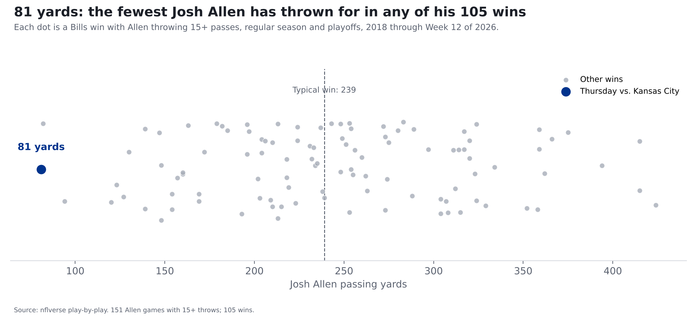

# Bills 13, Chiefs 10: Josh Allen threw for 81 yards, the fewest in any of his 105 wins, and Buffalo won anyway

**In the rain, with the wind listed at 19 mph, the Bills beat Kansas City on Tyler Bass's 57-yard field goal with 4 seconds left.
Josh Allen completed 10 of 21 passes for 81 yards with 2 interceptions, his lowest total in any win of his career.
Buffalo ran instead: 40 designed runs, 61% of its plays, and James Cook carried 32 times for 117 yards. The defense
held Patrick Mahomes' Chiefs to 10 points, something that has happened in only 5 of his 135 regular-season starts.**

## A different kind of win

Allen has thrown 15 or more passes in 151 games, regular season and playoffs. Only 1 of them had fewer passing yards than Thursday, and that
one was a loss. His next-lowest total in a win is 82. Buffalo didn't complete a pass of 20 yards or more, the 5th time that's happened in
143 Bills regular-season games since 2018.

What it did instead: 40 designed runs, 61% of its plays, the 6th-highest share in those 143 games. Cook scored the only Bills
touchdown, his 10th straight game with a touchdown.

## The rain, as forecast

Our model, which doesn't know about weather, projected 25.6 to 23.9. The teams scored 13 and 10. In [part 4](bills-chiefs-rain-and-wind.html)
we found teams in rain and a 10+ mph wind had scored about 18.3 points each, against 22.9 expected in dry games. Thursday came in well below even
that. One game proves nothing, but it was the kind of game the forecast pointed to.

## The recipe from part 3

[Part 3](bills-chiefs-slowing-mahomes.html) named three things that slowed Mahomes: pressure, no big pass plays, and stopping the run.

- **Big plays:** 2 of Kansas City's 31 dropbacks gained 20 or more yards (6%). In Mahomes' typical game since
  2023 it's 8%. Buffalo did this one.
- **The run:** Kansas City's runs worked 63% of the time, above Mahomes' typical game (41%). Buffalo, 27th against the run in part 3, didn't stop it.
- **Pressure:** the charting data isn't out yet. We'll add it when it is.

## Receipts

Both of our calls hit. The Bills won (55%), and Allen ran 7 times (4 designed runs, 3 scrambles), so "4 or more"
(80%) came in. Scores: 0.20 and 0.04, where 0 is perfect. Our record is now 15 of 24.

## For the stat-heads

- Allen games: passer with 15+ attempts (sacks excluded), regular season and playoffs, 2018 through 2026 Week 12. Wins: 105. Median passing yards in wins 239.
- Designed run share: `rush` = 1 over pass + rush plays (no kneels, spikes, two-point tries, no-plays). 20+ passes: dropbacks with `yards_gained` >= 20.
- Mahomes starts: 15+ dropbacks, regular season, 2018 on. Part 3 measures use 2023 on, as part 3 did; run "worked" = nflverse `success`.
- Weather from nflverse's game note ("Rain Temp: 33° F, Humidity: 97%, Wind: NE 19 mph").
- Ledger: P0024 Brier 0.2025; P0025 Brier 0.0400. 2026 play-by-play fingerprint through Week 12: (28843, -180.1391).
