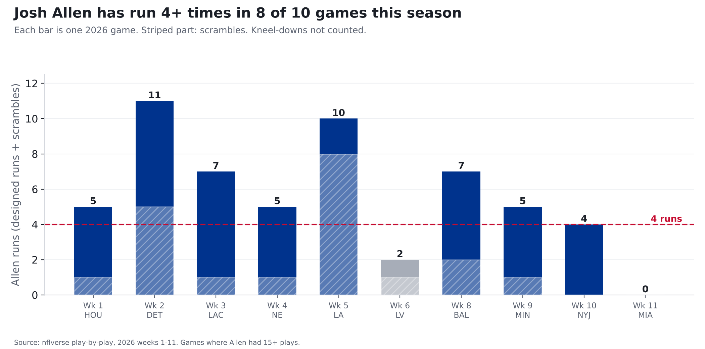

# Bills vs. Chiefs: we give Buffalo 55%, and Josh Allen 80% to run at least 4 times

**Two calls on the Ledger for Thursday night, logged Wednesday morning: the Bills beat the Chiefs (55%), and Josh Allen runs the ball 4 or more
times (80%). Our scoring model has Buffalo by about 2 points at home, 25.6 to 23.9. Allen has run at least 4 times in 8 of his
10 games. And the forecast has gotten wetter: rain all game, with gusts up to 35 mph.**

## Call 1: Bills win, 55%

The model projects each team's points from how many points its offense scores per drive this season and how many the other team's defense gives up,
blended with last season's numbers, plus home field. Buffalo projects to 25.6 and Kansas City to 23.9. To turn that into a win chance, we replay how far real games have landed from the
model's projections. A gap of under two points leaves plenty of room for either team, which is why it's 55%.

**How good is it?** In seasons it never saw (2024, 2025 and 2026 so far), its projections missed a team's actual score by 7.5 points on
average, against 7.9 for just guessing the league average. It landed within 7 points 55% of the time. The team it gave the better chance won
64% of the 657 games that didn't end in a tie.

## Call 2: Allen runs 4+ times, 80%

This one is simple: the share of Allen's games this season with 4 or more runs, counting designed runs and scrambles but not kneel-downs. He did it
in 8 of 10. Ten games is a small sample. The two times he didn't: Week 6 against LV (2) and Week 11 against MIA (0). His typical game this season has 5 runs. It's a plain season rate, not a model, and
the Ledger says so.

Will the rain change it? [Part 4](bills-chiefs-rain-and-wind.html) found NFL teams run more in the rain, but that counted designed runs by everyone,
mostly running backs, and no scrambles. It doesn't tell us about quarterbacks, so the 80% leaves the weather out.

## The weather, updated

Thursday morning's National Weather Service forecast for Orchard Park, from 8 to 11 p.m.: rain (88-100% chance each hour), 37-38 degrees,
a northeast to east wind of 10-13 mph with gusts of 29-35 mph, and about 0.66 of an inch of rain from 7 p.m. to 1 a.m. That's wetter
than Wednesday's forecast in part 4. In games with rain and a 10+ mph wind since 2018, each team scored 18.3 points on average, against the 22.9 we'd expect from the same offenses
and defenses in dry games.
The model above doesn't know about the weather; it projects a normal game.

## Catch up on Chiefs week

- [Part 1: Greg Rousseau leads the NFL in pressures, but the sacks lag](bills-chiefs-leonhard-file.html)
- [Part 2: who's left from the last playoff meeting](bills-chiefs-whos-left.html)
- [Part 3: how to slow down Patrick Mahomes](bills-chiefs-slowing-mahomes.html)
- [Part 4: rain, wind and the run game](bills-chiefs-rain-and-wind.html)

## Receipts

Both calls were logged Wednesday at 9:44 a.m. Eastern, before kickoff, and we'll grade them Friday. Win or lose, they stay on the [Ledger](../ledger.html).

## For the stat-heads

- Win: points-win-v0.1 (src/ledger/points_model.py), drive-level ratings through 2026 Week 11, home = BUF. Projections 25.61 / 23.86. Win chance = share
  of paired training misses (home, away) replayed on the projections in which BUF finishes ahead; ties after regulation split 50/50.
- Out-of-sample: mean absolute error 7.47 vs 7.90 (league-average guess); within 7 points 55.2%; win Brier 0.224 on 659 games, ties scored as half
  (50/50 guess = 0.250); the side given more than 50% won 63.8% of the 657 games without a tie.
- Allen runs: play-by-play `rush` with Allen as rusher plus `qb_scramble`; excludes kneels, two-point tries and no-plays; games with 15+ Allen plays. Per game: 5, 11, 7, 5, 10, 2, 7, 5, 4, 0.
- Ledger timestamps: P0024 and P0025 logged 2026-11-25T14:44:10Z UTC.
- 2026 play-by-play fingerprint (28141, -186.8888). Weather: NWS gridpoint BUF/39,42, updated 2026-11-26T14:57:46+00:00; saved in reports/weather/.
