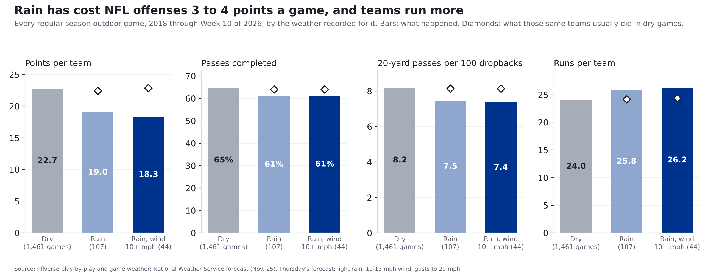

# Rain and wind Thursday night. Rain has cost NFL offenses 3 to 4 points a game, and it brings on the run

**The forecast for Thursday night in Orchard Park is light rain the whole game, with a 10 to 13 mph wind and gusts near 29 mph. In 107 rainy NFL games
since 2018, teams scored 19.0 points a game, about 3½ fewer than the same teams usually scored against the same opponents in dry weather.
They completed fewer passes, hit fewer long ones, and ran more. For Buffalo that cuts both ways. Rain takes away some of the long passes Buffalo's defense
has had trouble stopping, and brings more runs, which it has had even more trouble stopping.**

*Part 4 of our Bills-Chiefs series. [Part 1: Rousseau and the pass rush](bills-chiefs-leonhard-file.html). [Part 2: who's left](bills-chiefs-whos-left.html).
[Part 3: slowing Mahomes](bills-chiefs-slowing-mahomes.html).*

## The forecast

From the National Weather Service, as of Wednesday morning, for the hours of the game:

| Time (ET) | Temp | Wind | Gusts | Rain |
|---|---|---|---|---|
| 8 p.m. | 37° | NE 13 mph | 29 mph | 100%, light rain |
| 9 p.m. | 37° | NE 13 mph | 28 mph | 100%, light rain |
| 10 p.m. | 36° | NE 12 mph | 25 mph | 100%, light rain |
| 11 p.m. | 37° | NE 10 mph | 23 mph | 100%, light rain |

That's about 0.35 of an inch of rain from 7 p.m. to 1 a.m. It's not a snow game, and the wind eases as the night goes on. Forecasts this far out can change.

## What rain does to an offense

We sorted every regular-season outdoor game since 2018 by the weather recorded for it: 1,461 dry, 107 with rain, and a handful with snow
or only a chance of rain (left out). Then we compared them. In the rain:

- **Teams scored 19.0 points a game.** In dry games: 22.7.
- **They completed 61% of their passes**, against 65%.
- **7.5 of every 100 dropbacks went for 20 yards or more**, against 8.2.
- **They ran 25.8 times a game**, against 24.0.

Thursday looks most like the 44 games with rain and a wind of 10 mph or more. In those, teams scored 18.3 points a game, completed
61% of their passes and ran 26.2 times. For two teams throwing about 35 times each, that's roughly one fewer 20-yard pass
every other game. Long passes get harder, but they don't go away.

**How we checked it.** Rainy games could just involve worse teams. So for each rainy game we worked out what that offense usually did in dry outdoor games that
season, and what that defense usually allowed, and compared. The answer held: in the rain, teams scored 19.0 points when we'd expect 22.4. In rain with wind,
18.3 when we'd expect 22.9, about 4½ fewer. A third check, one calculation with every team's season built in, put rain at 3.4 fewer
points a team, and about 1.5 more for every 10 mph of wind.

## Buffalo's two weak spots

In part 3, Buffalo's defense ranked 20th at stopping big pass plays and 27th against the run. Rain helps with the first and leans on the second.
Kansas City's running game ranks 5th this season.

The last time these teams played in the rain in Orchard Park, on Oct. 19, 2020, Kansas City ran the ball 46 times for 245 yards and won
26-17.

## The quarterbacks

Josh Allen has played 13 outdoor games in the rain. He completed 58% of his passes, against 65% in dry outdoor games. Measured against his dry
games in the same seasons, so his rookie year doesn't skew it, we'd expect 65%. Thirteen games is a small sample.

Patrick Mahomes has started only two rainy games in that time. That's too few to say anything about him.

## What it means Thursday

Expect a lower-scoring game than either offense usually plays, more runs, and fewer long passes on both sides. The first part of slowing Mahomes in part 3,
pressure, doesn't depend on the weather. The other two do: the rain should help Buffalo against big plays, and put more weight on its run defense.

## For the stat-heads

- Games: regular season, `roof` outdoors or open, 2018 to 2026 Week 10. Team-game rows: pass + run plays, EPA not null, no two-point tries, kneels, spikes or no-plays.
- Weather class from the nflverse `weather` description (text before "Temp:"): rain/shower/drizzle = rain unless worded as a forecast
  ("possible", "chance", "threat", "scattered", "forecasted"); snow/flurries = snow. Games: dry 1,461, rain 107, snow 16, unsure 7.
  This is a pregame or game-time note, not a measured rain total.
- Wind: nflverse `wind` (mph), filled from the description's "Wind: N mph" when empty. Where both exist they agree within 1 mph 85% of the time.
  Rain games with no wind reading after the fill: 0.
- Rates: completions = `complete_pass` / (`pass_attempt` minus sacks); 20+ rate = dropbacks (`pass` = 1, incl. sacks and scrambles) with `yards_gained` >= 20;
  runs = `rush` = 1 per team-game. nflverse codes QB scrambles as `pass` = 1, so runs are designed runs (including QB keepers and sneaks).
- Expected values: offense's season rate in dry outdoor games + defense's season rate allowed in dry outdoor games - league dry outdoor rate, per team-game.
  Rain: pts 22.43, cmp 0.640, 20+ 0.0814, runs 24.17. Rain + wind 10+: 22.87, 0.640, 0.0814, 24.39.
- OLS with offense-season and defense-season fixed effects, dry + rain games with wind known: points rain -3.42, per mph -0.155;
  20+ rate rain -0.0061, per mph -0.00070 (weighted by dropbacks); runs rain +1.54, per mph +0.041. Thursday-like (rain + 12 mph) vs dry and calm: 5.3 points.
- Allen: games with 15+ dropbacks as passer or scrambler (gsis from PFR id AlleJo02). Rain n = 13; completion 0.578; dry outdoor 0.647; same-season expectation 0.651.
- 2020 game: `2020_06_KC_BUF`, KC `rush_attempt` = 1 (box-score carries, incl. kneels) 46 for 245 yards.
- BUF 2026 defense ranks (weeks 1-10): 20+ dropback rate allowed 20th, designed-run success allowed 27th; KC designed-run success 5th.
- Forecast: NWS gridpoint BUF/39,42, updated 2026-11-25T11:57:35+00:00; hourly temps and sustained wind from the hourly forecast, gusts from grid data (km/h converted),
  rain from the 00-06 UTC quantitative precipitation (7 p.m.-1 a.m. ET). Copy saved in `reports/weather/`.
