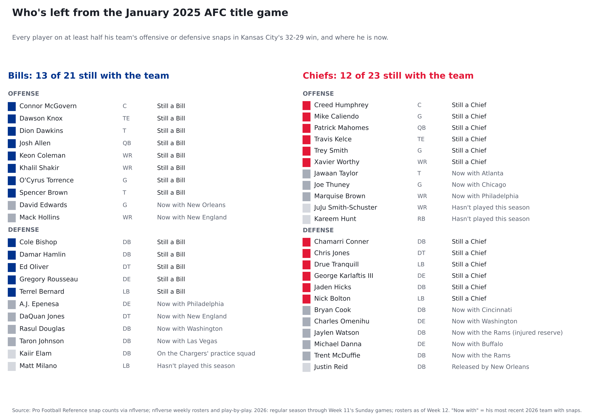

# Who's left from the AFC title game: Buffalo kept its offense, and both teams rebuilt their secondary

**Twenty-two months ago, Kansas City beat Buffalo 32-29 in the AFC Championship Game. Of the 21 Bills who played at least half the
offensive or defensive snaps that night, 13 are still Bills. Kansas City kept 12 of 23. Buffalo's offense is nearly intact: 8 of
10 regulars are back, starting with Josh Allen and 4 of the 5 offensive linemen. The big turnover on both sides is in the secondary: Kansas City has lost
4 of its 6 regular defensive backs from that game, and Buffalo 3 of 5.**

*Part 2 of our Bills-Chiefs series. [Part 1: the Leonhard file](bills-chiefs-leonhard-file.html).*

## Buffalo: same offense, new coaches, reworked defense

On offense, 8 of Buffalo's 10 regulars from that game are still Bills. Gone: David Edwards (New Orleans) and Mack Hollins (New England).

On defense it's 5 of 11. Still here: Cole Bishop, Damar Hamlin, Ed Oliver, Gregory Rousseau, Terrel Bernard.
Gone: A.J. Epenesa (Philadelphia), DaQuan Jones (New England), Kaiir Elam (the Chargers' practice squad), Matt Milano (hasn't played this season), Rasul Douglas (Washington) and Taron Johnson (Las Vegas).

The sideline changed too. Joe Brady called Buffalo's plays in that game as offensive coordinator. He's now the head coach and still calls them.
Pete Carmichael is the new offensive coordinator, and Jim Leonhard, [hired from Denver in January](https://www.nfl.com/news/bills-hiring-broncos-assistant-head-coach-jim-leonhard-as-defensive-coordinator), runs the defense.

## Kansas City: same quarterback and tight end, a new secondary

On offense, 6 of Kansas City's 11 regulars are still Chiefs, including Patrick Mahomes, Travis Kelce, Xavier Worthy and center Creed Humphrey.
Gone: Jawaan Taylor (Atlanta), Joe Thuney (Chicago), JuJu Smith-Schuster (hasn't played this season), Kareem Hunt (hasn't played this season) and Marquise Brown (Philadelphia).

On defense, 6 of 12. Chris Jones, George Karlaftis III and Nick Bolton are still there. Most of the secondary isn't:
Bryan Cook (Cincinnati), Jaylen Watson (the Rams, injured reserve), Justin Reid (released by New Orleans) and Trent McDuffie (the Rams). Also gone from the front: Charles Omenihu (Washington)
and Michael Danna, who crossed over. Danna played 58% of Kansas City's defensive snaps in that game and is now a Bill (1 game this season).

Andy Reid and defensive coordinator Steve Spagnuolo are back. The offensive coordinator is new:
[Eric Bieniemy replaced Matt Nagy](https://www.yardbarker.com/nfl/articles/chiefs_make_double_coaching_decision_on_thursday/s1_17615_43398657) after the 2025 season.

## Who Mahomes throws to now

| Chiefs receiver, 2026 | Targets | Share | Targeted in the Jan. 2025 game? |
|---|---|---|---|
| Travis Kelce | 57 | 18% | Yes |
| Xavier Worthy | 54 | 17% | Yes |
| Rashee Rice | 44 | 14% | No |
| Kenneth Walker III | 36 | 11% | No |
| Emmett Johnson | 27 | 9% | No |

Players who were targeted in that title game have drawn 35% of Kansas City's targets this season. For Buffalo it's 71%:

| Bills receiver, 2026 | Targets | Share | Targeted in the Jan. 2025 game? |
|---|---|---|---|
| Khalil Shakir | 54 | 19% | Yes |
| DJ Moore | 48 | 17% | No |
| Dalton Kincaid | 41 | 14% | Yes |
| Keon Coleman | 40 | 14% | Yes |
| Ty Johnson | 26 | 9% | Yes |

## What it means Thursday

Buffalo's offense is the most familiar group on the field: the same quarterback and play-caller, most of the same line and most of the same targets.
Kansas City has replaced most of its secondary from that game, and Buffalo has a new defensive coordinator. The history between these teams is real, but only
about half of the defenders from that game are still on the same side.

## How we counted

We started with Pro Football Reference's snap counts for the AFC Championship Game played Jan. 26, 2025 and kept every player who was on the field for at least
half his team's offensive or defensive plays. For example, Michael Danna played 42 of Kansas City's defensive snaps. Then we looked up each player's
2026 snaps through Week 11's Sunday games (Monday night's Cincinnati-Washington game hadn't been played), and his latest weekly roster status. "Still with the team" means he has played for the same team this season. A team in parentheses is the last team he played for this season.

## For the stat-heads

- Regular in the game: offense_pct >= 0.5 or defense_pct >= 0.5 in 2024_21_BUF_KC (BUF 21, KC 23). Special-teams-only players excluded.
- 2026 status: any offensive or defensive snap in 2026 regular-season games through Week 11 (162 of 163 games; 2026_11_CIN_WAS not yet played). Released and practice-squad labels: Week 12 weekly roster (CUT, DEV).
- No 2026 offensive or defensive snaps: JuJu Smith-Schuster (KC, not on a 2026 weekly roster), Kareem Hunt (KC, not on a 2026 weekly roster), Matt Milano (BUF, not on a 2026 weekly roster).
- Targets: nflverse `receiver_player_id` on pass attempts; sacks, two-point tries and no-plays excluded. KC 2026 316, BUF 2026 287.
- Defensive backs: positions CB, S, FS, SS.
