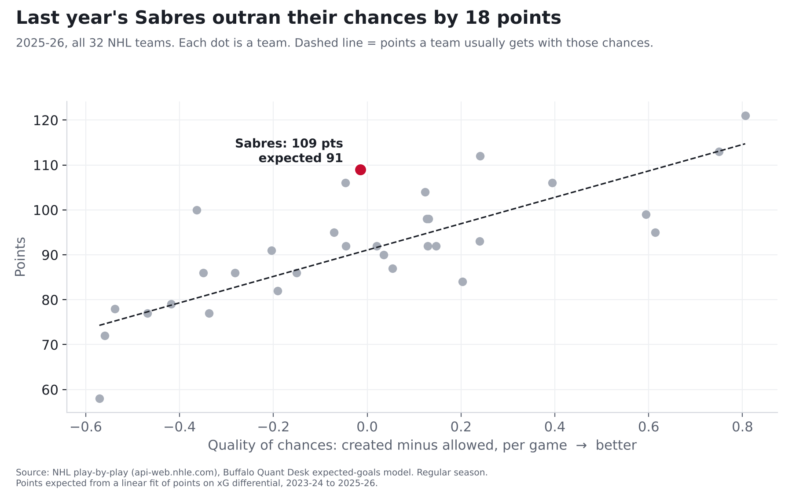

# The Sabres' 50-win season was built on goals that weren't supposed to happen

**Finding: Based on the scoring chances they created and gave up, last year's Sabres played like a 91-point
team. They finished with 109. Only one team in the NHL outran its chances by more. The difference came from hot
goaltending and hot shooting, and those rarely last.**

*This season: 15 games (7-5-3). That's still a small sample.*

## How we measure "chances"

Not every shot is equal. A rebound from the top of the crease goes in far more often than a wrist shot from the blue
line. We looked at more than 336,000 NHL shots from the last three seasons and worked out how often each kind of shot actually goes in. Add that up for a team and you get **expected goals**: how
many goals an average team would score with the same chances.

A team that scores far more than its expected goals is either very skilled or very lucky, and history says that kind of
edge usually doesn't last.

## Last season, in plain numbers

| | What happened | What their chances said | Difference |
|---|---|---|---|
| Goals the Sabres scored | 256 | 237 | **+19** (hot shooting) |
| Goals the Sabres allowed | 221 | 238 | **+17** (hot goaltending) |

That's about 36 goals better than their chances, roughly one extra goal every two games. By chances
alone they were a middle-of-the-pack team (17th of 32).

## Why it didn't carry over

We checked every NHL team over three seasons. Some things a team does well one year, it usually does well the next.
Other things bounce around.

| What we measured | Does it carry over to next season? |
|---|---|
| Creating more good chances than you give up | **Strong** |
| Shooting percentage (finishing) | **Weak** |
| Save percentage (goaltending) | **Weak** |

Last season the Sabres' shooting and goaltending luck combined ranked 2nd in the league. This season it ranks
26th.

## What it means for this season

Through 15 games the Sabres are earning 17 points, about 1.13 a game. Last season's chances
pointed to about 1.11 a game. **This isn't a collapse. It's the team their chances always said they were,
without last year's luck.**

## For the stat-heads

- Expected goals (xG): our own gradient-boosted model on shot distance, angle, type, rebounds, rush chances and
  manpower, trained on 336,462 unblocked shots, 2023-24 to 2025-26. Out of sample on 2025-26 it beat a
  distance-and-angle model (AUC 0.77 vs 0.71). 2023-26 values are in-sample; 2026-27 is out of sample. Each
  season is rescaled so league xG equals league goals (the raw model ran +3.0% hot in 2025-26). Empty nets
  excluded.
- Last season: goals 256 vs xG 237.2; goals against 221 vs xGA 238.4.
  xGF% 49.9% (17th). This season xGF% 47.8% (22nd), -1.8 vs xG.
- Year-to-year correlations, 32 teams, 63 team pairs: xGF% 0.72, shooting % 0.32,
  save % 0.21, PDO 0.31. "Strong" means 0.6 or higher, "Weak" means under 0.4. PDO (shooting % +
  save %, 5-on-5) was 1.019 last season and is 0.983 now.
- Expected points: a straight-line fit of points on xG differential per game, all 96 team-seasons 2023-24 to 2025-26
  (r = 0.77; typical miss 9.7 points). Doesn't model overtime, shootouts or empty-net goals.
