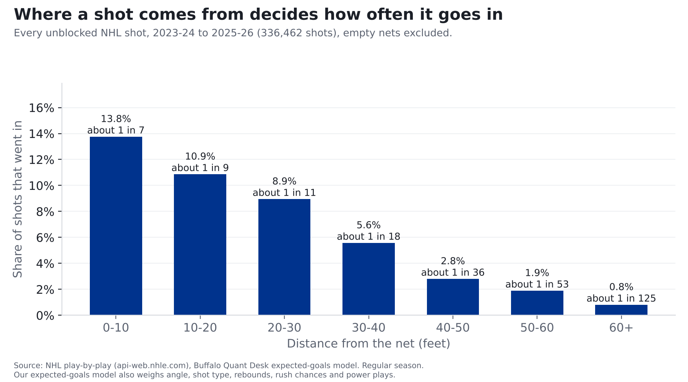

# The Sabres' 50-win season was built on goals that weren't supposed to happen

**Finding: Based on the scoring chances they created and gave up, last year's Sabres played like a 91-point
team. They finished with 109. Only one team in the NHL outran its chances by more. The difference came from hot
goaltending and hot shooting, and those usually fade.**

*This season: 15 games (7-5-3). That's still a small sample.*

## Where "chances" comes from

**The source:** the NHL logs every shot in every game: where on the ice it was taken (to the foot), what kind of shot
it was, whether it came right after another shot, and how many players each team had on the ice. It's public, and
we pull it from the league's own public game feed.

**The reasoning:** some shots are far more dangerous than others. We took 336,462 NHL shots from the last three seasons
and counted how often each kind actually went in.

- A shot from within 10 feet of the net went in 13.8% of the time (about 1 in 7).
- From 30 to 40 feet: 5.6% (about 1 in 18).
- From 60 feet or more: 0.8% (about 1 in 125).
- A rebound (a shot within three seconds of a teammate's shot) went in 11.5% of the time, against 6.3% for
  other shots.
- On the power play, shots went in 9.9% of the time, against 6.2% otherwise.

**The math:** a computer model combines all of those factors (distance, angle, shot type, rebound, rush, manpower)
and gives every shot a probability of going in. A shot from in close is worth about 0.14 of a goal;
a long shot from 60 feet or more, about 0.01. Add up every shot a team takes in a season and you get its **expected goals**: how many goals an
average NHL team would have scored with exactly the same shots.

**The check:** we tested the model on a full season it had never seen. It predicted which shots would go in clearly
better than a simple distance-and-angle model, and over a season its totals land within a few percent of the
actual goals scored league-wide.

So when we say last year's Sabres had chances worth 237 goals, it means: add up the odds on every Sabres shot
last season and that's what you get. They scored 256. Scoring 19 more than an average team would from the
same shots is either elite finishing or luck, and the rest of this story shows that kind of edge usually doesn't carry
into the next season.

## Last season, in plain numbers

| | What happened | What their shots were worth (expected goals) | Difference |
|---|---|---|---|
| Goals the Sabres scored | 256 | 237 | **+19** (hot shooting) |
| Goals the Sabres allowed | 221 | 238 | **+17** (hot goaltending) |

That's about 36 goals better than their chances, roughly one extra goal every two games. By chances
alone they were a middle-of-the-pack team (17th of 32).

## Why it didn't carry over

We checked every NHL team over three seasons. Some things a team does well one year, it usually does well the next.
Other things bounce around.

| What we measured | Does it carry over to next season? |
|---|---|
| Creating more good chances than you give up | **Strong** |
| Shooting percentage (finishing) | **Weak** |
| Save percentage (goaltending) | **Weak** |

Last season the Sabres' shooting and goaltending luck combined ranked 2nd in the league. This season it ranks
26th.

## What it means for this season

Through 15 games the Sabres are earning 17 points, about 1.13 a game. Last season's chances
pointed to about 1.11 a game, and this season's chances point to about 1.01. **This isn't a collapse. Without last year's luck, they're about where their chances say they should be.**

## For the stat-heads

- Expected goals (xG): our own gradient-boosted model on shot distance, angle, type, rebounds, rush chances and
  manpower, trained on 336,462 unblocked shots, 2023-24 to 2025-26. Out of sample on 2025-26 it beat a
  distance-and-angle model (AUC 0.77 vs 0.71). 2023-26 values are in-sample; 2026-27 is out of sample. Each
  season is rescaled so league xG equals league goals (the raw model ran +3.0% hot in 2025-26). Empty nets
  excluded.
- Last season: goals 256 vs xG 237.2; goals against 221 vs xGA 238.4.
  xGF% 49.9% (17th). This season xGF% 47.8% (22nd), -1.8 vs xG.
- Year-to-year correlations, 32 teams, 63 team pairs: xGF% 0.72, shooting % 0.32,
  save % 0.21, PDO 0.31. "Strong" means 0.6 or higher, "Weak" means under 0.4. PDO (shooting % +
  save %, all situations) was 1.019 last season and is 0.983 now.
- Expected points: a straight-line fit of points on xG differential per game, all 96 team-seasons 2023-24 to 2025-26
  (r = 0.77; typical miss 9.7 points). Doesn't model overtime, shootouts or empty-net goals.
