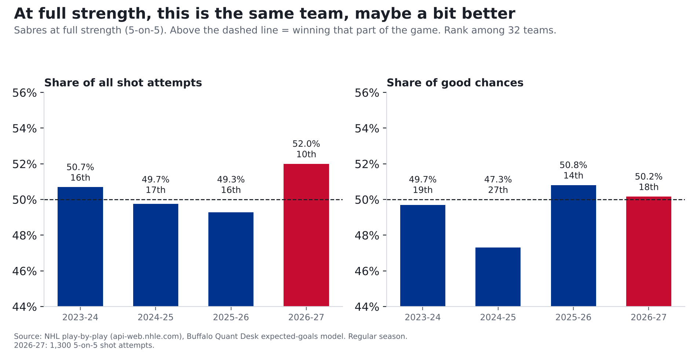

# At even strength, these Sabres look like last year's Sabres

**Finding: When both teams are at full strength, which is most of every game, the Sabres are playing as well as last
season, maybe a bit better. They're taking 52% of the shot attempts (10th in the NHL) and an even share of the
good chances. What changed is that last year's lucky bounces have evened out, and the penalty kill is leaking.**

*2026-27 is 15 games (7-5-3), a small sample.*

## How we measure who's controlling the game

Two simple questions. **Who's shooting more?** If you take more than half the shot attempts, you usually have the
puck more. **Who's getting the better chances?** **Expected goals**, in one sentence: we looked at more than 336,000 NHL shots and worked out how often each kind (by distance, angle, shot type, rebound or rush) goes in. Add those odds up and you get how many goals an average team, or an average goalie, would produce from the same shots.

| Season | Share of shot attempts (rank) | Share of good chances (rank) | Goals for-against at 5-on-5 |
|---|---|---|---|
| 2023-24 | 51% (16th) | 50% (19th) | 174-159 |
| 2024-25 | 50% (17th) | 47% (27th) | 185-184 |
| 2025-26 | 49% (16th) | 51% (14th) | 194-156 |
| 2026-27 | 52% (10th) | 50% (18th) | 30-29 |

Above 50% means the Sabres are winning that part of the game. They've been right around even all four seasons.

## So what changed?

Put all five of our Sabres stories together and the picture is simple:

- **At full strength, it's the same team.** It's no longer getting last year's lucky bounces.
- **The goalies** went from stealing games to about average.
- **The shooters who stayed** went from scoring way above their chances to slightly below, within normal ups and downs.
- **The penalty kill** is giving up a lot more. That's the biggest single change.

That's how a 109-point team turns into a 17-point start in 15 games.

## For the stat-heads

- Expected goals (xG) come from our own model: gradient-boosted trees on shot distance, angle, type, rebounds, rush chances and manpower, trained on 336,462 unblocked shots from 2023-24 to 2025-26. Tested on a season it never saw (2025-26), it beat a distance-and-angle model (AUC 0.77 vs 0.71). Empty-net shots are excluded. Values for 2023-24 to 2025-26 come from a model fit on those seasons; 2026-27 is out of sample. Each season is rescaled so league expected goals equal league goals (the raw model ran +3.0% hot in 2025-26), so above-expected numbers are relative to that season's league average.
- 5-on-5 only, empty nets excluded. Shot-attempt share = CF% (Corsi, blocked shots included). Good-chance share = xGF%.

| Season | CF% (rank) | xGF% (rank) | 5v5 GF-GA | PDO |
|---|---|---|---|---|
| 2023-24 | 50.7% (16th) | 49.7% (19th) | 174-159 | 1.002 |
| 2024-25 | 49.7% (17th) | 47.3% (27th) | 185-184 | 1.005 |
| 2025-26 | 49.3% (16th) | 50.8% (14th) | 194-156 | 1.021 |
| 2026-27 | 52.0% (10th) | 50.2% (18th) | 30-29 | 0.992 |

PDO = 5-on-5 shooting % + save %, a common luck gauge: 1.021 last season, 0.992 now.
