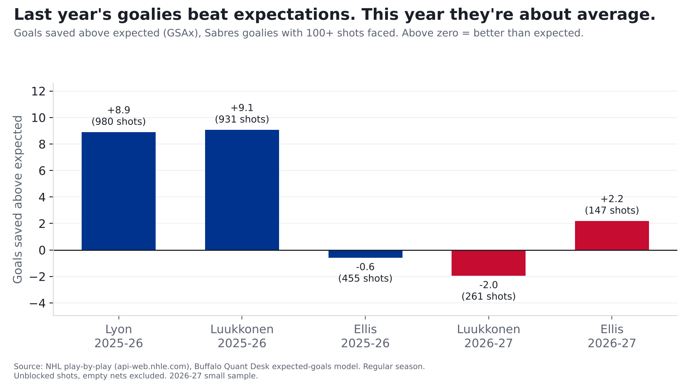

# The Sabres' goalies aren't the problem. They're just not the bailout anymore.

**Finding: Ukko-Pekka Luukkonen's .874 save percentage looks like a collapse, but his expected save percentage,
based on the shots he's faced, is .881. He is -2.0 goals against expectation and
Colten Ellis is +2.2. Last year Sabres goalies were +17.4, and about half of that was Alex Lyon, who hasn't dressed for an NHL game this season.**

*2026-27 is 15 games (7-5-3), a small sample. 261 shots for Luukkonen, 147 for Ellis.*

| Season | Goalie | Shots faced | Save % | Expected save % | Goals saved above expected |
|---|---|---|---|---|---|
| 2023-24 | Ukko-Pekka Luukkonen | 1470 | 0.910 | 0.903 | +10.9 |
| 2023-24 | Devon Levi | 666 | 0.899 | 0.894 | +3.4 |
| 2023-24 | Eric Comrie | 254 | 0.874 | 0.885 | -2.7 |
| 2024-25 | Ukko-Pekka Luukkonen | 1490 | 0.887 | 0.895 | -12.7 |
| 2024-25 | James Reimer | 597 | 0.899 | 0.894 | +3.1 |
| 2024-25 | Devon Levi | 258 | 0.872 | 0.905 | -8.6 |
| 2025-26 | Alex Lyon | 980 | 0.906 | 0.897 | +8.9 |
| 2025-26 | Ukko-Pekka Luukkonen | 931 | 0.909 | 0.899 | +9.1 |
| 2025-26 | Colten Ellis | 455 | 0.903 | 0.905 | -0.6 |
| 2026-27 | Ukko-Pekka Luukkonen | 261 | 0.874 | 0.881 | -2.0 |
| 2026-27 | Colten Ellis | 147 | 0.891 | 0.876 | +2.2 |

League save % on these shots: 0.896 in 2025-26, 0.890 in 2026-27. League expected save %:
0.896 and 0.890.

## What changed

- **Lyon hasn't played.** He was +8.9 on 980 shots last season and has not dressed for any NHL team in 2026-27.
- **Luukkonen is facing harder shots.** His expected save % is 0.881, against 0.899 last season;
  among 62 goalies with 100+ shots this season that is 9th-hardest.
- **Combined**, Sabres goalies are +0.2 this season after +17.4 last season.

Save percentage is one of the least stable stats in the sport (see the companion piece on last season). A
261-shot sample says very little about Luukkonen either way.

## Method and caveats

- Expected goals (xG) come from our own model: gradient-boosted trees on shot distance, angle, type, rebounds, rush chances and manpower, trained on 336,462 unblocked shots from 2023-24 to 2025-26. Tested on a season it never saw (2025-26), it beat a distance-and-angle model (AUC 0.77 vs 0.71). Empty-net shots are excluded. Values for 2023-24 to 2025-26 come from a model fit on those seasons; 2026-27 is out of sample. Each season is rescaled so league expected goals equal league goals (the raw model ran +3.0% hot in 2025-26), so above-expected numbers are relative to that season's league average.
- Goals saved above expected = expected goals on unblocked shots faced minus goals allowed. Blocked shots and
  empty-net situations are excluded; deflections and screens are only partly captured.
