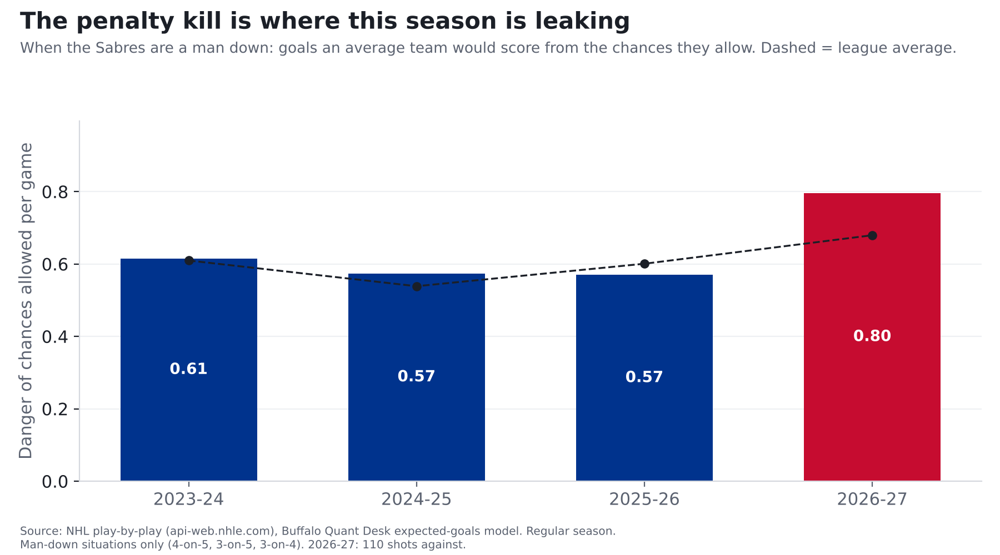

# The Sabres' penalty kill is where this season is leaking

**Finding: When the Sabres are a man down, they've given up 17 goals in 16 games, 30th of 32 teams.
Last season they were 4th. Some of that is bad luck, but they're also giving up more dangerous chances than
most teams (24th of 32). Of everything that's changed since last season, this is the biggest.**

*2026-27 is 16 games (8-5-3), a small sample.*

## What the numbers say

**Where "chances" comes from:** the NHL logs where every shot is taken and what kind it is. Across 336,462 shots, those from within 10 feet went in 13.8% of the time; from 60 feet or more, 0.8%. Our model gives every shot those odds, and adding them up gives **expected goals**: what an average team (or goalie) would produce from the same shots. The full explanation is in our lead Sabres story, [The 50-win mirage](sabres-50-win-mirage.html).

| Season | Power-play goals allowed | League rank (1 = fewest) | Danger of chances allowed per game (rank) | League average |
|---|---|---|---|---|
| 2023-24 | 49 | 16th | 0.61 (22nd) | 0.61 |
| 2024-25 | 57 | 30th | 0.57 (24th) | 0.54 |
| 2025-26 | 39 | 4th | 0.57 (11th) | 0.60 |
| 2026-27 | 17 | 30th | 0.80 (24th) | 0.68 |

Two things are happening:

1. **Bad luck.** Opponents have scored 17 power-play goals on chances an average team would turn into about
   13. That part tends to even out.
2. **More dangerous chances.** The Sabres are allowing chances worth 0.80 goals a game while shorthanded, up from
   0.57 last year and above this season's league average of 0.68. Most teams are allowing a bit more this
   year, but Buffalo is allowing more than most.

**What to watch:** the luck should fade. The chances allowed are the part that has to get fixed. It's early, too:
110 shots against while shorthanded. A bad penalty kill isn't new, either. In 2024-25 it ranked 30th in goals allowed.

## For the stat-heads

- Expected goals (xG) come from our own model: gradient-boosted trees on shot distance, angle, type, rebounds, rush chances and manpower, trained on 336,462 unblocked shots from 2023-24 to 2025-26. Tested on a season it never saw (2025-26), it beat a distance-and-angle model (AUC 0.77 vs 0.71). Empty-net shots are excluded. Values for 2023-24 to 2025-26 come from a model fit on those seasons; 2026-27 is out of sample. Each season is rescaled so league expected goals equal league goals (the raw model ran +3.0% hot in 2025-26), so above-expected numbers are relative to that season's league average.
- Shorthanded = 4-on-5, 3-on-5, 3-on-4 (excludes 4-on-6 and 3-on-6 with a goalie pulled). "Danger of chances" =
  xGA per game. Per-game rates don't adjust for how often a team is shorthanded; time-on-ice isn't in our dataset yet.

| Season | PP GA | xGA | GA/gm (rank) | xGA/gm (rank) | League xGA/gm |
|---|---|---|---|---|---|
| 2023-24 | 49 | 50.4 | 0.60 (16th) | 0.61 (22nd) | 0.61 |
| 2024-25 | 57 | 47.1 | 0.70 (30th) | 0.57 (24th) | 0.54 |
| 2025-26 | 39 | 46.7 | 0.48 (4th) | 0.57 (11th) | 0.60 |
| 2026-27 | 17 | 12.7 | 1.06 (30th) | 0.80 (24th) | 0.68 |
