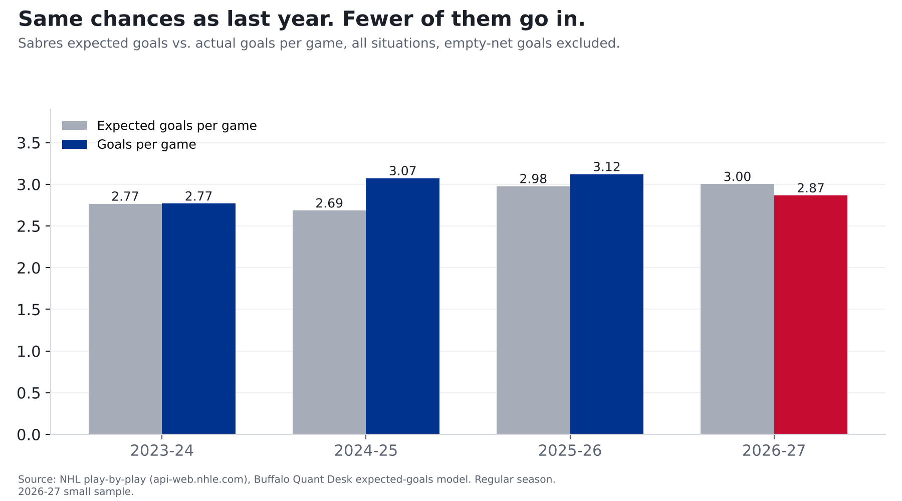

# Same chances, fewer goals: the Sabres' shooters have gone cold

**Finding: The Sabres are generating 3.00 expected goals per game, about the same as last season's 2.98,
but scoring 2.87 a game, down from 3.12. Last season's finishing surplus came from players who are
still here: they scored +11.7 goals above expected then and are -3.8 this season.**

*2026-27 is 15 games (7-5-3), a small sample. League average: 2.99 expected goals per team per game this season.*

## It isn't Alex Tuch

Tuch was last season's best finisher relative to his chances (32 goals on 23.8 expected, +8.2),
and he now plays elsewhere. But the 13 departed skaters who shot for Buffalo last season combined for
49 goals on 48.9 expected (+0.1). Tuch's surplus was cancelled out by others who left.

2025-26 leaders, all situations, empty nets excluded:

| Player | Goals | Expected | Above expected | Gone? |
|---|---|---|---|---|
| Alex Tuch | 32 | 23.8 | +8.2 | Yes |
| Tage Thompson | 37 | 31.1 | +5.9 |  |
| Mattias Samuelsson | 12 | 6.1 | +5.9 |  |
| Noah Ostlund | 11 | 7.1 | +3.9 |  |
| Sam Carrick | 5 | 1.9 | +3.1 |  |

## This season's leading scorers

| Player | Goals | Expected | Above expected |
|---|---|---|---|
| Tage Thompson | 10 | 6.8 | +3.2 |
| Jack Quinn | 8 | 5.7 | +2.3 |
| Noah Ostlund | 4 | 4.5 | -0.5 |
| Olen Zellweger | 3 | 1.6 | +1.4 |
| Josh Norris | 2 | 2.8 | -0.8 |

The top of the lineup is still finishing (Tage Thompson and Jack Quinn are above expected), so the drop is
spread through the rest of the roster.

## Why it matters going forward

Finishing above or below expected moves a lot from year to year (team shooting % has a year-to-year correlation
of about 0.3). The chances are still there. If the shooters drift back toward normal, goals should follow, though
probably not to last season's level, which was itself above normal.

## Method and caveats

- Expected goals (xG) come from our own model: gradient-boosted trees on shot distance, angle, type, rebounds, rush chances and manpower, trained on 336,462 unblocked shots from 2023-24 to 2025-26. Tested on a season it never saw (2025-26), it beat a distance-and-angle model (AUC 0.77 vs 0.71). Empty-net shots are excluded.
- Individual expected goals count a player's own unblocked shots. "Departed" = dressed for Buffalo in 2025-26 and
  not yet in 2026-27, from game rosters. Per-game rates use all 15 games.
